hum LKG UKG Nursery k liye alag repo rakehnge tum suggest karna naam jaise NextSemKG ✅

logo ko redraw karo using C:\Users\Manoj\nextsemorg\NextSemNCERT\docs\images for reference\icon-ncert-official-3d.png  and C:\Users\Manoj\nextsemorg\NextSemNCERT\docs\images for reference\NCERT.png  using same theme colour as of our app with a text inside NCERT by NextSem ✅
simplify the design with neccessary changes according NEP 2026 and our app's brand guidelines also remove all the existing design that are not according to NEP 2026 and our app's brand guidnsso that everything is consistent with our brand . ✅

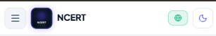 in this area i want to have hamburger menu then logo with app name. ✅

aur ek baat logo m jo ncert ki image use ki hai use theme k according use karo dark k liye alag image aur light k liye alag. ✅

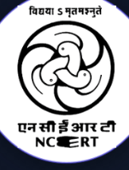 ✅

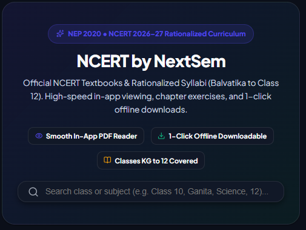 ✅

front page pe hi saari class show ho aur har class k andar saare subjects show ho jispe click krte hi us subject ka page open ho aur fir m aage bataunga. ✅

logo m jo text hai "BY NEXTSEM" use ese likho "by NextSem" ✅

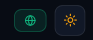 ✅

 ✅

 ✅

4 icon hi rakho bottom navigation m Home  | dyanmic classes/subject | search | bookmark  aur login aur theme toggle wahi pe menu banakr rakh do aur hamburger ko bhi rehne do hum baad m hamburger pe kaam karenge. ✅

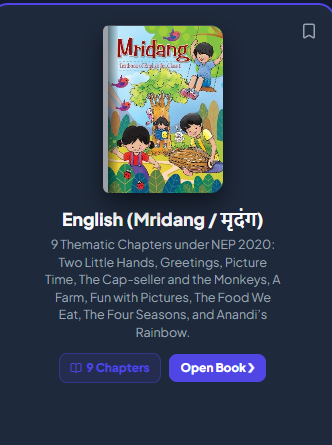 ✅

aur ek jaroori baat jaise 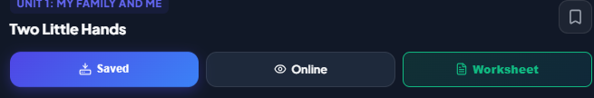 ✅

class 10 class 11 aur class 12 NEP k under new books nahi bani hai iske bss syllabus kam hue hai isliye new syllabus likhna new books nhi ✅

class 11 aur 12 k andar arts commerce aur science k liye subsection bna kar books show karo. ✅

class 1 se class 5 tak k liye interface jab book select ho jaye kid friendly rakho badi image bade text aur dudu bubu  ✅

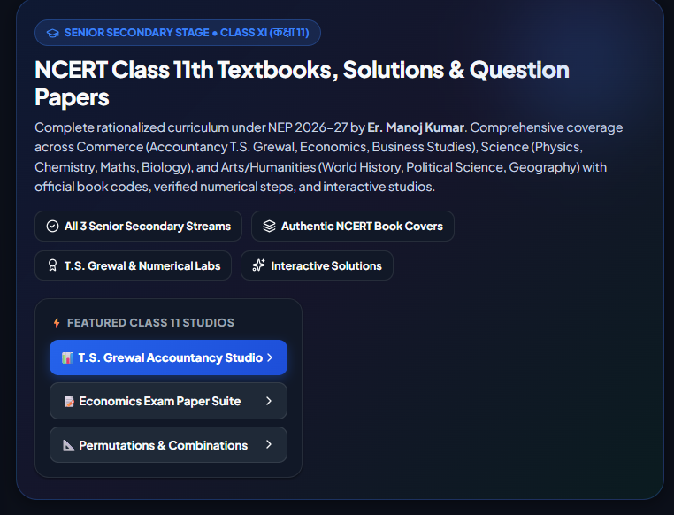 ✅

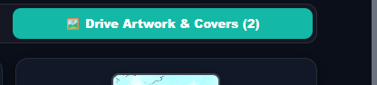 ✅
![tino m se kisi bhi link pe click krne se kaam hona chanhiye jaise m dekh ra hu worksheet pe click krne se ek nayi windows open hotu hai par kuch show nhi h0ta online pe click krne se new widow open hoti hai par m nhi chahta pdf new window sm open ho aur saved pe click krne se  file jo user ne download kar rakhi thi wo open ho matl hamare app m kuch esa bano ki jab user kisi fiel ko download kare tab wi file app k kisi folder m dwonload ho jaye aur jab user wpas app open karei to wo file wahi se open ho jab user saved pe click karei](image-15.png) ✅

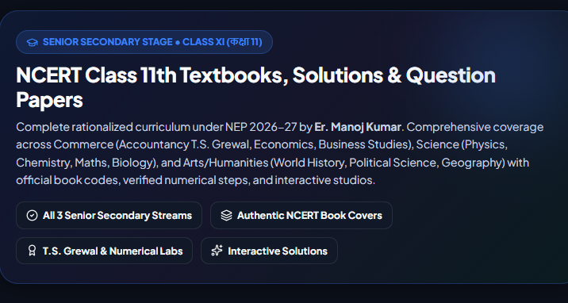 mtkb phone pe user ko jyad ascroll na karn apade easy banao taki user har baar hamara app use karin books reda download krne k liye ✅

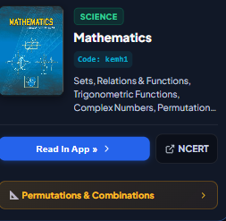 ✅

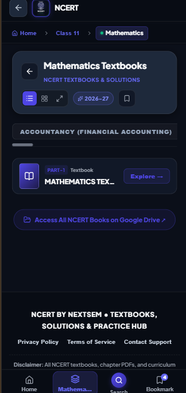 ✅

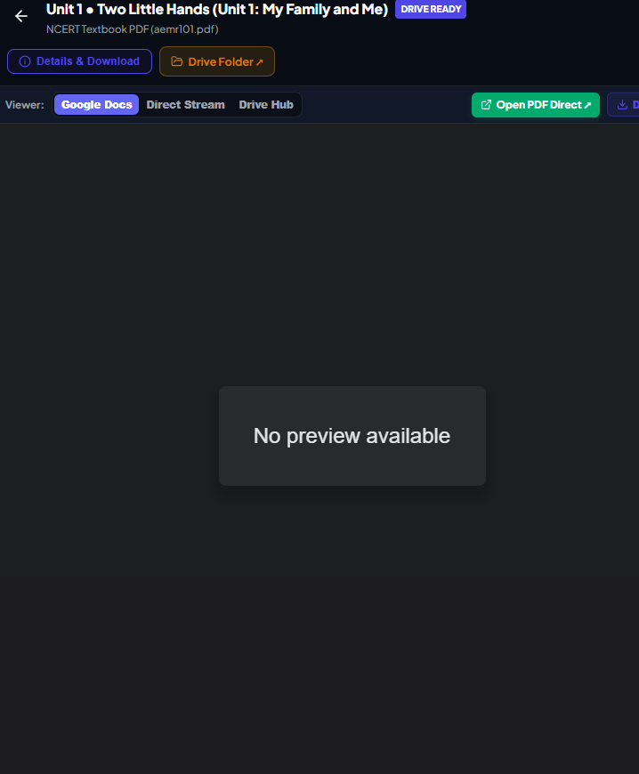 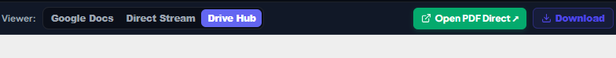 ✅

aur ek baat kya saare classes ki saare subjects ki pdf google drive pe ordered way m hai ya nhi ye rahi google drive ki files G:\My Drive dhyan ahe meen files newncert.nextsem@gmail.com wale accountpe save kar rakha hai

Higher Classes (Class 11, Class 12, Class 9, Class 6, Class 7, Class 8): PDFs bohot hi achhe ordered subfolders me stored hain (11th Maths, 12th Physics Part-I, 6th Jigyasa, etc.).
Primary Classes (Class 2 to Class 5): Jo subjects uploaded hain wo perfectly chapter-wise (demm101.pdf, desa101.pdf, eemm101.pdf) hain, lekin kuch subjects (jaise Hindi Veena ya Class 3 Maths Mela) Drive par upload hona abhi baaki hain.
Hamare web app me humne NCERT official CDN fallback configure kar rakha hai, isliye jo chapters drive par nahi bhi hain, wo bhi app me officially load ho jaate hain!
tum  drive se links automatically sync karne ka tool banayein! ✅

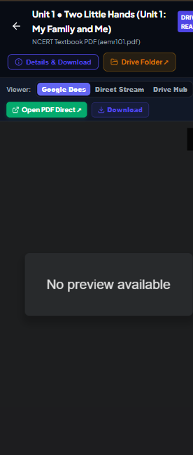 ✅

after everything is one make .aab under 10Mb to be uploaded to playstore 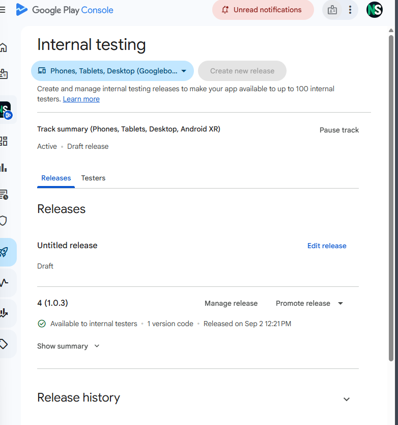 ✅

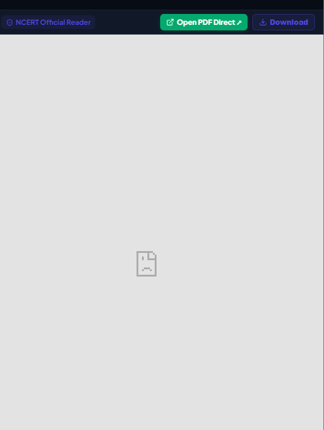default official ncert viewr m file pehle google drive se show krne ki koshish karo agar na mile tab ncert.nic.in se try karo ✅

deploy it ✅

Student records vault and backup architecture configured on GitHub, GitLab, and H:\My Drive (nextsem.academy@gmail.com) with schemas, attendance, fees, and auto-sync runner ✅

aur https://nextsem-students-2026.web.app/ ye bhi humne hi banaya hai par iska git repo nex.tseacacdemy@gmail.com pe hai aur wo account suspend ho gy ✅ hai

    🚀 Rescued & Secured Status:

Local Git Initialized & Committed (46 Files, 53,000+ lines preserved):

c:\Users\Manoj\nextsemorg\nextsem-students-2026 me fresh local Git repository (main branch) initialize karke poora code commit kar diya hai.
Files like attendance.html, auth.js, camera-attendance.html, pdf-to-worksheet, academics, vault.html sab 100% safe hain.

Google Drive Cloud Backup Saved:

Rescued Zip Archive: H:\My Drive\01_Administration\Students\Secure_Backups\nextsem_students_2026_rescued_source.zip (24.15 MB) ✅
Iska matlab ab account suspend hone par bhi aapka single line code ya data loss nahi hua hai!

ok very nice now let us do as you say

abhi m ye use kar ra hu https://github.com/nextsem-manoj?tab=repositories ✅
dono repos successfully pushed and synced to https://github.com/nextsem-manoj (nextsem-students-2026 & NextSemVault) ✅

pehle github pe kaam karte hai fir gitlab pe bhi upload karenge.
